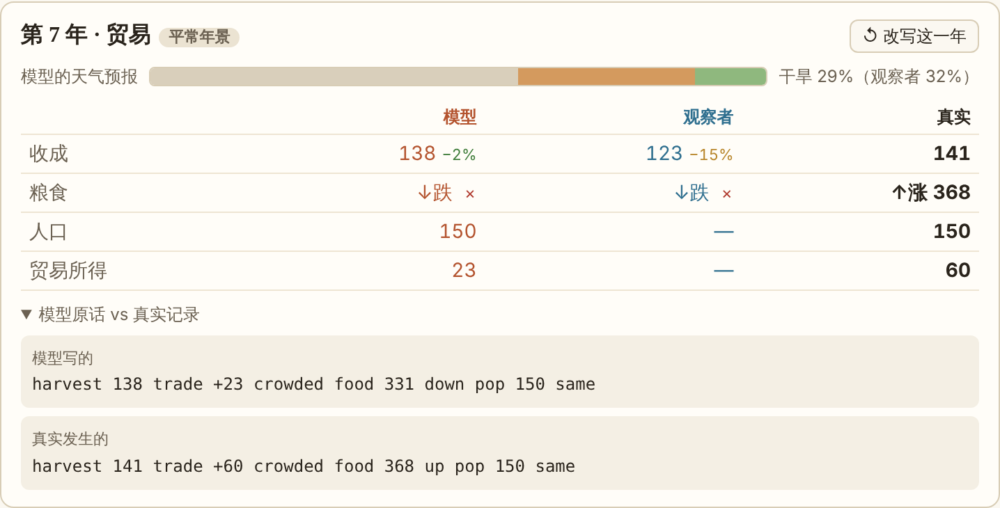
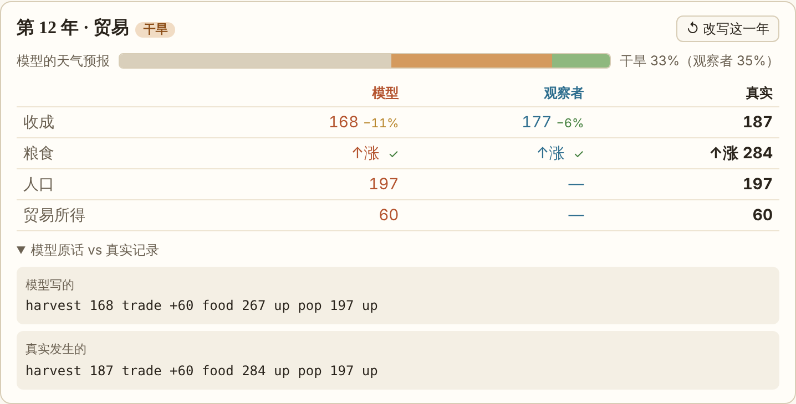
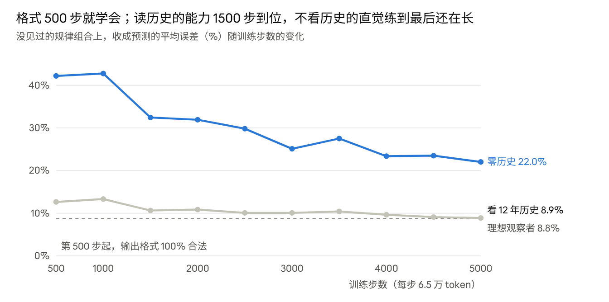
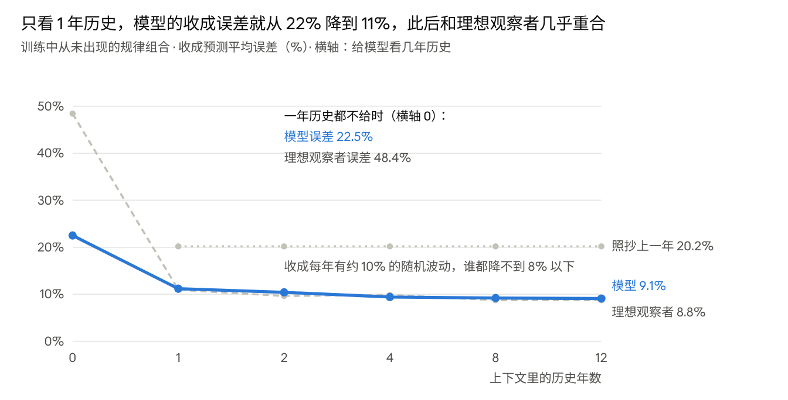
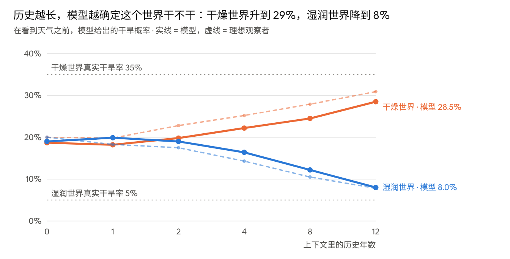
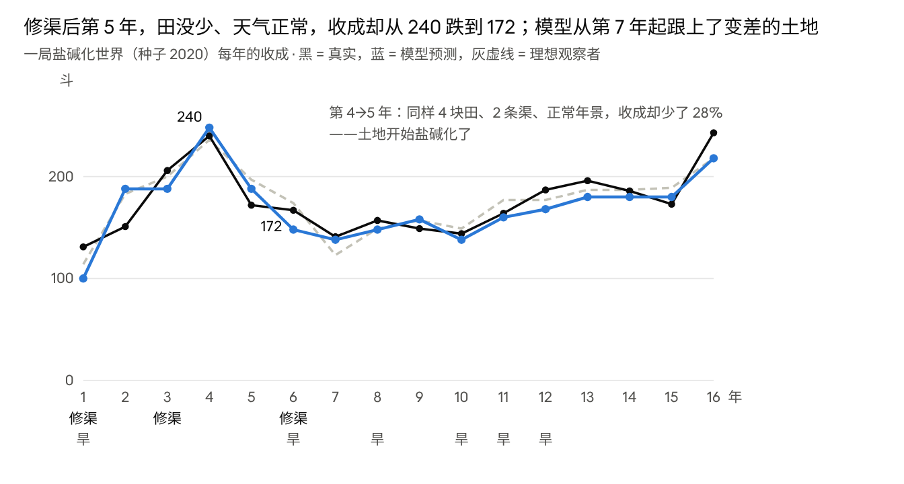
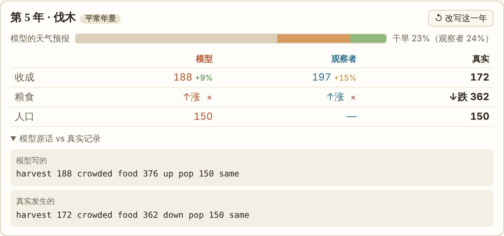
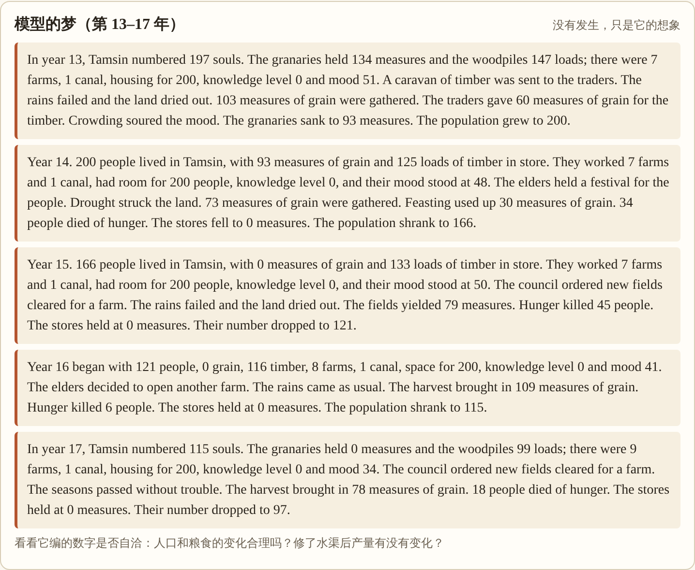
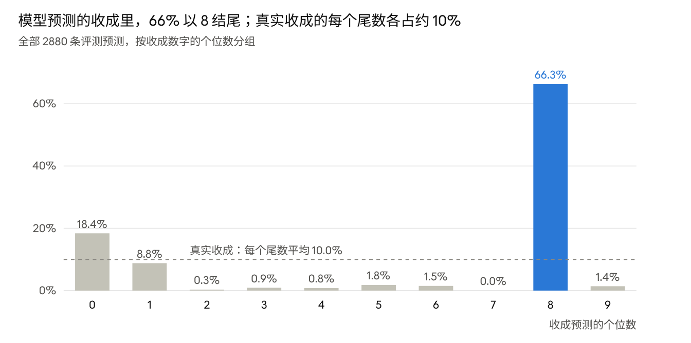
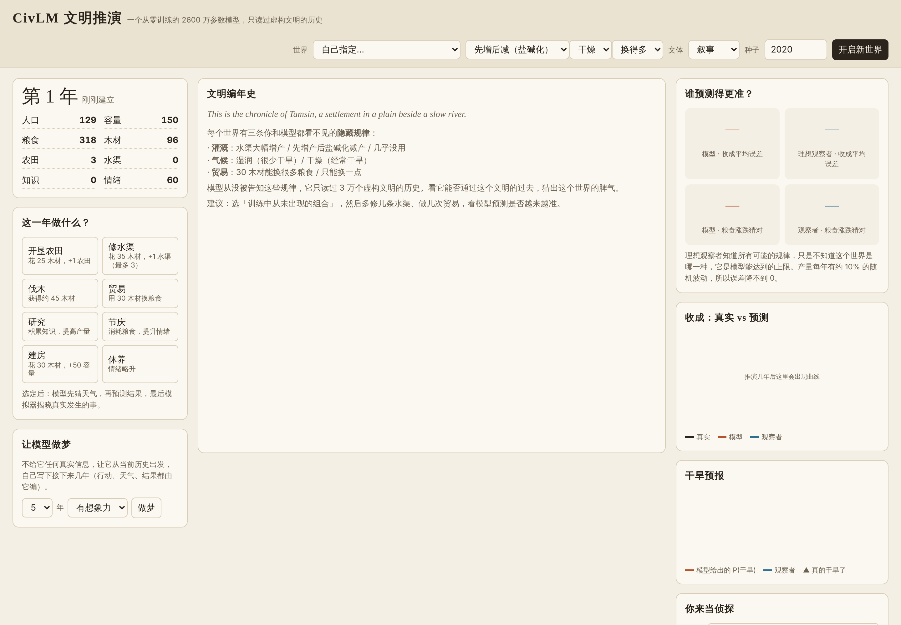

# 它没学过物理，但它发现了盐碱地

一个只有 2600 万参数、只读过假历史书的小模型，在一个它从没见过的世界里，只看了一次贸易就记住了这个世界的汇率。

第 7 年，塔姆辛村第一次把 30 车木材送给商人。模型预测能换回 23 斗粮食，实际换回了 60 斗。它猜错了，但错得合理：在它读过的 3 万个文明里，有一半的世界商人很抠门。

第 12 年，塔姆辛村第二次去做贸易。这一次模型写下“trade +60”，一斗不差。





没有人告诉过它这个世界的贸易是“富”还是“穷”。它也没有任何参数更新，所有“学习”都发生在它正在读的这段历史里。这篇文章讲的就是这件事：一个小语言模型，能不能只靠读历史，看出一个陌生世界的脾气。

## 我造了一个有脾气的世界

我先写了一个很小的文明模拟器：一个村庄，每年做一件事，然后结算收成、粮食、人口和情绪。可选的事有 8 件：开垦农田、修水渠、伐木、贸易、研究、节庆、建房、休养。

关键在于，每个世界都有三条**隐藏规律**：

| 规律 | 可能的取值 | 效果 |
| --- | --- | --- |
| 灌溉 | 大幅增产 / 盐碱化 / 几乎没用 | 每条水渠 +30% / 先 +30%，之后土地逐年变差 / 只 +5% |
| 气候 | 湿润 / 干燥 | 每年干旱概率 5% / 35% |
| 贸易 | 富 / 穷 | 30 木材约换 66 斗 / 约换 21 斗 |

此外，每个世界的土地肥力和汇率还有 ±15% 的随机差异，每年收成另有约 10% 的随机波动。所以即使知道规律，也不可能预测得分毫不差。

12 种规律组合里，我故意藏起 2 种，训练时一次也不让模型见到：“盐碱化 + 干燥 + 富贸易”和“大幅增产 + 湿润 + 穷贸易”。每个单独的规律它都见过，只是没见过这种搭配。后面所有“陌生世界”的测试都用这 2 种。

模型从来没被告知这张表。它能拿到的只有历史记录，长这样：

```
Y5 pop 138 food 313 wood 80 farms 3 canals 2 cap 150 tech 0 mood 60
act trade
weather drought
harvest 118 trade +63 food 277 down pop 141 up
```

同一段历史还有一个英文叙事版本，比如“The fields yielded 118 measures. The granaries sank to 277.”，同一件事有好几种说法，防止模型只背模板。

## 读假历史长大的模型

我用模拟器生成了 3 万个文明，每个 40 年，写成约 1.05 亿 token 的历史书。模型是一个 2600 万参数、结构和 LLaMA 相同的小 Transformer，从随机初始化开始，只做一件事：预测下一个词。在 Colab 的 A100 上训练了 5000 步，共读了 3.3 亿 token（约 3 遍），验证损失从 7.04 降到 0.157。

损失降下来，只说明它会写历史了，不说明它懂了世界。所以我每 500 步存一个检查点，拿去做同一个测试：在没见过的世界里预测下一年的收成。



三种能力是分阶段长出来的。第 500 步它就能 100% 写出格式正确的历史；给它看 12 年历史时，预测误差在 1500 步左右就接近了理想上限。一点历史都不给时，它的误差从 42% 一路降到 22%，到训练结束还在下降。为什么零历史也能越来越准，下一节会讲。

## 实验一：历史侦探

在没见过的世界里，只给模型看 1 年历史，它对下一年收成的预测误差就从 22% 降到 11%；看到 12 年时是 9.1%，理想观察者是 8.8%。

做法是在一个陌生世界里随机选一年，只给模型看前面 k 年的历史，再告诉它这一年的行动和天气，让它续写结果。为了知道“好”是多好，我还写了两个对手：

- **照抄上一年**：去年收成多少，就猜今年多少。
- **理想观察者**：一个作弊的算法，它知道所有可能的规律和公式，只是不知道眼前是哪一种，用贝叶斯推断去猜。它代表信息允许的上限。



有两个地方值得细看。

**第一，一年历史就够了**。一次收成就暴露了这块土地有多肥，之后剩下的误差主要来自每年 10% 的随机波动，谁也猜不中。小模型和作弊的算法几乎打成平手。

**第二，一点历史都不给时，模型反而比作弊的算法准一倍**：22% 对 48%。我的解释是，理想观察者只从收成记录里推断，而模型还会读当年的状态：人口、存粮、农田数。一个 4 块田、却只养得起 100 人的村子，土地大概不怎么样。这就像侦探进门看一眼厨房，就能猜出主人的家境。没人教过它这么做，前一节的学习曲线里，这是长得最慢、到最后还在进步的那种能力。（这个解释还没做专门的实验验证。）

更漂亮的是天气。天气没法从一年历史里看出来，只能数过去发生了几次干旱。模型正是这么做的：



一开始它对所有世界都报 19% 左右，刚好是两种气候的平均。然后随着历史变长，两条线分开，分开的速度和做贝叶斯推断的观察者几乎一样。它的推断略微保守一些，在干燥世界里比观察者低 2 到 3 个百分点。

## 实验二：盐碱地

平均数会把故事抹平，所以我亲自玩了一局。世界选的是训练里没有的组合：盐碱化 + 干燥 + 富贸易。前 6 年我修了 3 条渠。在这个世界里，水渠先让产量大涨，然后把土地一年年变咸。



第 5 年是关键。农田和水渠都没变，天气正常，收成却从 240 跌到 172。模型预测 188：它没猜中跌得这么狠，但它已经预言会跌，而且比理想观察者的 197 更接近真相。



从第 7 年起，土地肥力已经跌到谷底，模型的预测也稳住了：之后 10 年里，有 8 年的误差在 10% 以内。它不再把 3 条渠当成丰收的保证，而是按这块田现在的样子去估。

要说清楚的是：模型学到的是“这个世界的收成水平”，而不是一句“这里会盐碱化”的结论。从外面看不出它头脑里的想法；要验证它是否真的“知道”，需要下一个实验。

## 实验三：平行宇宙

同样是多修 2 条渠，模型认为在“大幅增产”的世界里能多收 2285 斗粮，在盐碱化的世界里只多收 559 斗。真实答案是 2299 斗和 656 斗。

游戏里的“改写这一年”可以从任意一年分叉，两条历史的天气和随机波动完全相同，只有你的选择不同。我用它做了一组对照：

- **历史 A**：第 3 年和第 6 年各修一条渠，一共 3 条。
- **历史 B**：这两年改去伐木，只有 1 条渠。

其他行动一模一样。同一个种子，分别在两种灌溉规律的世界里各跑一遍，统计第 3–16 年共 14 年的总收成：

| 世界 | 真实：A − B | 模型预测：A − B | 真实总收成 A / B |
| --- | --- | --- | --- |
| 灌溉大幅增产 | +2299 斗 | +2285 斗 | 6118 / 3819 |
| 灌溉会盐碱化 | +656 斗 | +559 斗 | 2525 / 1869 |

模型不仅猜对了“修渠划算”，还猜对了划算多少：在增产世界里，修渠的好处是盐碱化世界的 3.5 倍，模型给出的是 4.1 倍。

顺便一提，盐碱化世界里修渠也还是划算的。因为哪怕只有 1 条渠，土地也会变咸，而水渠还能抵抗干旱。这个结论我自己写规则时都没想到。

有一个限制要说明：这里的模型是逐年预测的，每年都能看到这条分支到上一年为止的真实历史，并不是在第 3 年就一口气想象完 14 年。让它完全靠自己想象，是下一节的内容。

## 它在做梦

让模型自己往下写 5 年，行动、天气、结果全由它编，它写出了一场完整的饥荒，而且饥荒里的死亡人数几乎完全符合模拟器的公式。



这个干燥世界里，它梦见 5 年里有 3 年干旱，粮仓见底，人口从 200 掉到 97。然后我拿模拟器的公式去核对它编的数字。规则是“粮食缺口每 2 斗，饿死 1 人”：

| 梦里的年份 | 缺口（存粮 + 收成 − 口粮） | 公式应饿死 | 模型写的 |
| --- | --- | --- | --- |
| 14 | 93 + 73 − 30（节庆）− 200 = −64 | 32 | 34 |
| 15 | 0 + 79 − 166 = −87 | 44 | 45 |
| 16 | 0 + 109 − 121 = −12 | 6 | 6 |
| 17 | 0 + 78 − 115 = −37 | 19 | 18 |

人口的加减法每一年都对（200 − 34 = 166，166 − 45 = 121……）。没人告诉过它“缺 2 斗死 1 人”，它是从几万场虚构饥荒里自己总结出来的。

梦里也有荒诞的地方。人一直在饿死，议事会却从 7 块田一路开到 9 块。可只剩 115 个人，按每块田 25 人算，只种得了 4 块半。有意思的是，它编的收成（78 斗）恰好符合“人手不够、田空着”的情况。它知道多出来的田没用，却还是让议事会去开，因为训练数据里那个随机策略在缺粮时就是爱开田。它学到了世界的物理，也学到了统治者的坏习惯。

## 它懂了什么，没懂什么

先说它学会了的：记账（人口、存粮的加减几乎从不出错），饥荒的规则，从 1 年历史读出土地肥力，从干旱次数推断气候，看一次就记住汇率。在训练从没出现过的规律组合上，这些能力都照样成立。

再说一个暗藏的破绽：它的幸运数字是 8。



原因不神秘。收成有 10% 的随机波动，个位数本来就猜不了，模型在 0–9 之间几乎是平均下注。评测时我用的是“每步只取最可能的那个字”，哪怕 8 只比别的数字高一点点，每次也都会选它。这提醒我们，它不是在“计算”收成，而是一位一位地猜：百位、十位猜得很准，个位就随便挑一个。

还有三点要诚实说：

- **这个任务可能太简单了。**一年历史就能摸清收成水平，所以“历史越长越准”的曲线在第 1 年就平了。只有天气预报真正需要长历史。
- **理想观察者不完美。**它不会从人口和存粮里读线索，所以零历史时输给了模型。“模型比上限还准”应该理解为“我的上限写得不够强”。
- **这是一个虚构世界。**它学会的是这个小模拟器的规律，不说明它能读懂真实的人类历史。

下一步我想做三件事：加入更慢显现的规律（比如盐碱化要十年才看得出），逼它真正依赖长历史；把模型扩到 1 亿参数，看差距会不会拉开；以及直接问它“这个世界修渠好不好”，看它能不能把自己的判断说出来。

想自己试试的话，按仓库 README 的步骤启动游戏，就能和它一起推演文明。把世界设成“先增后减”，然后多修几条渠。


